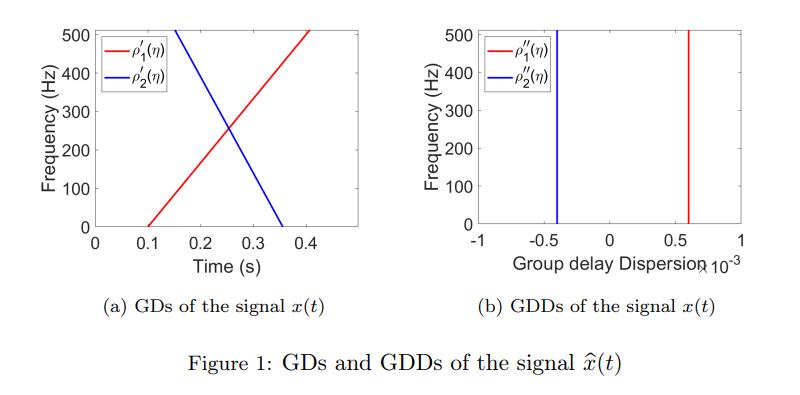
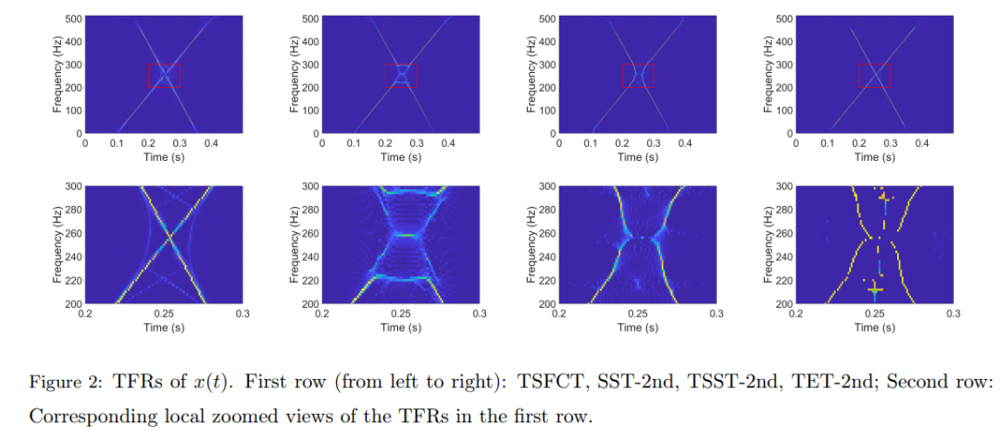
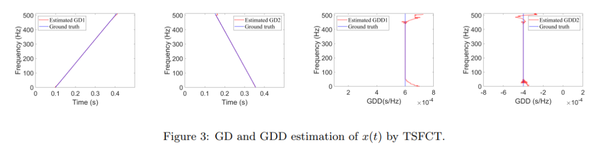
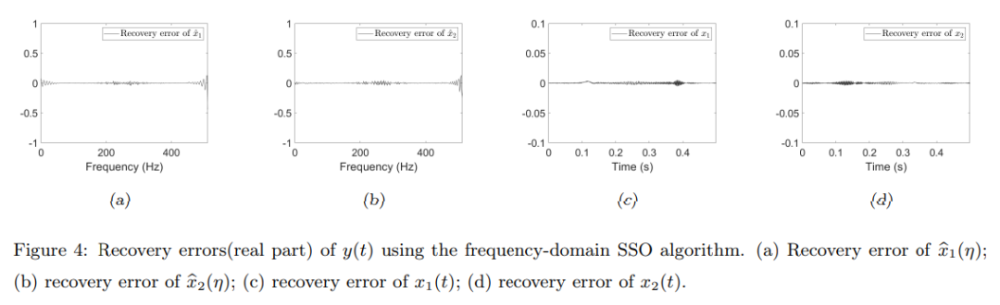
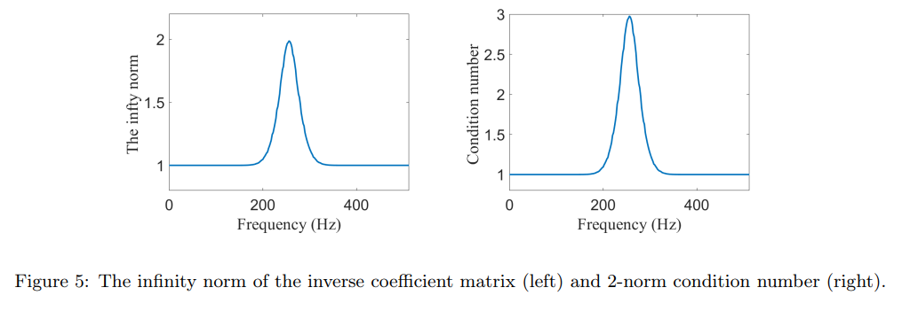
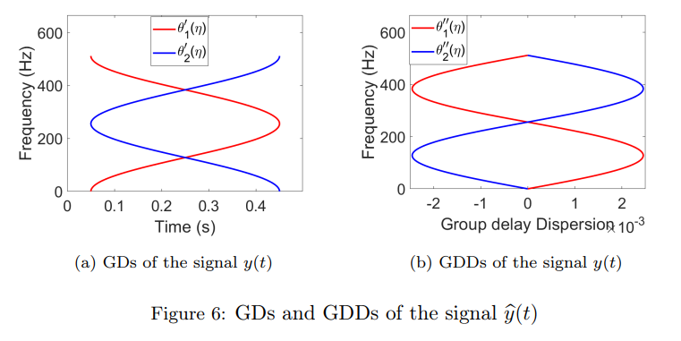
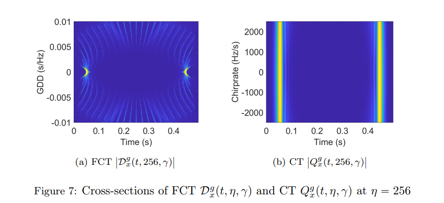
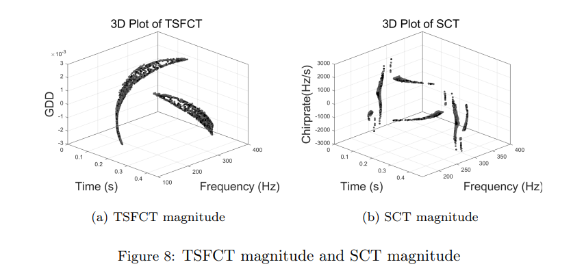
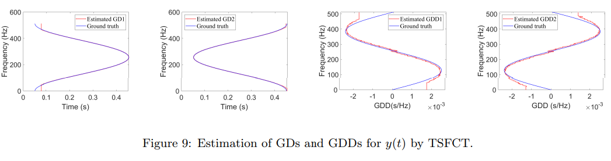
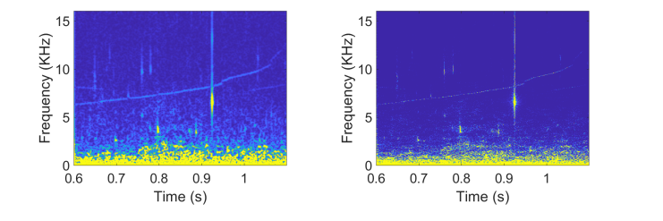

# Time-Frequency Analysis: Time-Frequency Reassignment Synchronization for Intersecting Group Delay Multicomponent Signals with Linear Frequency Modulation Wavelet Transform [with MATLAB Code]

Personal Blog: https://www.cnblogs.com/EWFrontier  
✿Focusing on Intersecting Group Delay Curves in Multi-component Signals, Time-Frequency Redistribution and Squeezed Frequency Domain Linear Wavelet Transformation  
1. Article Title: Time-Frequency Redistribution and Squeezed Frequency Domain Linear Wavelet Transformation for Multi-component Signals with Intersecting Group Delay Curves  
2. Abstract: In recent years, scholars have proposed the Time-Frequency Redistribution and Squeezed Frequency Domain Linear Wavelet Transformation (TSST) and its variants to analyze signals with rapid frequency changes or transient components. Unlike traditional squeezed transforms, TSST squeezes time-frequency coefficients along the group delay (GD) trajectory rather than the instantaneous frequency trajectory. Although the TSST method performs well in analyzing transient signals, it has inherent limitations when dealing with multi-component signals with intersecting group delay curves—a limitation that reduces the accuracy of feature extraction and signal component restoration, thereby significantly weakening the interpretability of the time-frequency representations (TFRs). This issue is particularly prominent in broadband signal processing systems, where the linearity of phase response is crucial, and the precise measurement of group delay dispersion (GDD) is essential.  
Given the superior performance of frequency domain signal modeling in characterizing signals with rapid frequency changes, this paper proposes a novel three-dimensional time-frequency-group delay dispersion (TF-GDD) representation based on the frequency domain linear wavelet transform (FCT), and further introduces the Time-Frequency Redistribution and Squeezed Frequency Domain Linear Wavelet Transformation (TSFCT) to achieve more concentrated TF-GDD distribution and more accurate group delay estimation. To address mode recovery issues, this paper designs the Frequency Domain Group Signal Separation Operation (FGSSO). Theoretical contributions include: deriving the approximation error of reference functions for group delay and group delay dispersion, and establishing a mode recovery error bound based on FGSSO. Experimental results show that the proposed TSFCT and FGSSO methods can effectively estimate group delays and recover modes, even for modes with intersecting group delay trajectories.  
Keywords: Frequency Domain Linear Wavelet Transform; Intersecting Group Delay Curves; Time-Frequency Redistribution and Squeezed Frequency Domain Linear Wavelet Transformation; Mode Recovery
Three. Introduction
Natural signals are typically composed of multiple overlapping non-stationary components, and Time-Frequency Analysis (TFA) serves as a core tool to characterize the dynamical properties of the signal in both its time domain and frequency domain, making it a key method for decomposing such multi-component signals. Traditional linear time-frequency analysis techniques, especially Short-Time Fourier Transform (STFT) and Continuous Wavelet Transform (CWT), are constrained by the Heisenberg Uncertainty Principle, necessitating an inevitable trade-off between temporal resolution and spectral resolution, preventing simultaneous optimization of both. Although quadratic representations like the Wiener-Khinchin distribution theoretically offer superior resolution, they inevitably generate cross terms when analyzing multi-component signals, severely limiting their practical application value.
In actual signal processing applications, enhancing the time-frequency resolution of TFA methods to precisely reveal the underlying features of signals remains a core requirement. The Reweighted Method (RM) was introduced with the aim of sharpening the time-frequency representation and improving energy concentration, but it cannot reconstruct the original signal. To address this limitation, scholars proposed Synchronous Squeezing Transform (SST), which enhances the readability of the time-frequency representation and restores the mode by concentrating time-frequency coefficients along instantaneous frequency (IF) trajectories, becoming a powerful tool for non-stationary signal analysis and giving rise to a series of high-resolution time-frequency representation techniques including Second-Order SST, Higher-Order SST variants, Synchronous Extraction Transform (SET), Multi-Synchronous Squeezing Transform (MSST), and Adaptive SST.
Moreover, Linear Frequency Modulation Wavelet Transform (CT) and Wavelet-Linear Frequency Modulation Wavelet Transform (WCT) have also been used to handle multi-component signals with intersecting instantaneous frequency trajectories. These transforms extend the traditional time-frequency and time-scale frameworks to three dimensions, forming the Time-Frequency-Scale (TFC) and Time-Scale-Frequency (TSC) domains respectively. Under specific conditions, even with intersecting instantaneous frequencies, these methods can still effectively separate the components of non-stationary multi-component signals; when applying synchronous squeezing techniques in three dimensions, more concentrated TFC representations can be obtained, significantly enhancing the separation effect of signal components.
However, while the aforementioned method can effectively handle non-stationary signals with instantaneous frequency variations, it faces significant challenges when analyzing signals with rapid frequency changes or transient components. This limitation has spurred the development of Time-Frequency Synchronized Squeezing Transform (TSST)—different from traditional SST, TSST squeezes time-frequency coefficients along the group delay trajectory but still encounters issues with energy dispersion in strong frequency-varying signals. Subsequent scholars have optimized performance through second-order TSST, transient extraction transform (TET), and Newtonian time extraction wavelet transform among other improvements. However, existing TSST methods still have fundamental limitations in distinguishing intersecting group delay curves, leading to decreased accuracy in feature extraction and component restoration, and affecting system performance in broadband signal processing systems due to inaccurate measurement of group delay dispersion.
Frequency-domain linearly time-varying wavelet transform (FCT) was initially used to characterize the group delay component of frequency variation. This paper extends the FCT framework to three-dimensional time-frequency-group delay dispersion (TF-GDD) space, achieving effective separation of multicomponent signals with intersecting group delay curves. Furthermore, drawing on the three-dimensional synchronization squeezing technique of linearly time-varying wavelet transform, we construct reference functions for group delay and group delay dispersion (also known as reassignment operators), and propose three-dimensional time-frequency reassignment synchronization squeezing frequency-domain linearly time-varying wavelet transform (TSFCT). This transform provides a more concentrated representation of TF-GDD, significantly enhancing feature extraction capabilities, thereby improving the accuracy of transient signal mode recovery. Additionally, this paper derives an approximation error theorem between the reference function for group delay/group delay dispersion and the true signal values. To recover transient signal modes that may have intersecting group delay curves, we extend the signal separation operation (SSO) framework from STFT and CWT to three-dimensional TF-GDD space, proposing Frequency-Domain Group Signal Separation Operation (FGSSO), effectively extracting multicomponent transient signal modes and establishing a modality recovery error definition based on FGSSO.
IV. Method Introduction The core method of this paper revolves around Frequency Domain Linear Frequency Modulation Wavelet Transform (FCT), Time-Frequency Redistribution Synchronized Squeezing Frequency Domain Linear Frequency Modulation Wavelet Transform (TSFCT), and Frequency Domain Group Signal Separation Operation (FGSSO). The specific core content is as follows:
1. Frequency Domain Linear Frequency Modulation Wavelet Transform (FCT)
2. Time-frequency redistribution and simultaneous frequency domain linear time-varying wavelet transform (TSFCT) for the problem of time-frequency concentration in intersecting group delay signals, this paper constructs a reference function for group delay (GD) and group delay dispersion (GDD) based on FCT. By taking the partial derivative of the FCT expression and combining the Courant-Fischer theorem, a simple reference function expression is derived, which can accurately approximate the true GD and GDD of the signal. Based on this, the definition of TSFCT is: Synchronous compression of FCT coefficients along the reference function trajectories of GD and GDD in three-dimensional TF-GDD space to obtain a more concentrated time-frequency representation. This transformation can effectively overcome the energy dispersion issue in the intersection group delay scenario of traditional TSST, and improve the estimation accuracy of GD and GDD.
3. Frequency Domain Group Signal Separation Operation (FGSSO) aims to achieve mode recovery for multi-component signals, and this paper extends the group signal separation framework to the TF-GDD space. Firstly, by using a three-dimensional ridge extraction method, the GD and GDD ridges of each mode are extracted from the time-frequency representation of TSFCT; then, a linear equation system is constructed, linking the Fourier transform of each mode with FCT coefficients; finally, the precise separation of each mode is achieved through solving the equation system (or pseudo-inverse). FGSSO can effectively suppress mode interference, especially suitable for mode recovery in scenarios with intersecting group delay.
4. Error Analysis
This paper establishes two types of key error theorems: one is the approximation error bound for reference functions of GD and GDD with respect to the true signal values, which quantifies the estimation accuracy of reference functions through defining a signal class (characterizing multi-component signals satisfying specific regularity conditions in the frequency domain); the other is the mode recovery error bound based on FGSSO, revealing the correlation between restoration errors and the estimation accuracy of GD/GDD, as well as the norm of the inverse coefficient matrix, providing theoretical assurance for the reliability of the method.
5. Conclusion
This paper proposes a method based on the Frequency Domain Linear Frequency-Modulated Wavelet Transform (FCT) for processing multi-component signals with intersecting group delay (GD) curves. By introducing a new variable for group delay dispersion (GDD), FCT extends the traditional two-dimensional time-frequency (TF) plane to a three-dimensional time-frequency-group delay dispersion (TF-GDD) space. Compared with the traditional linear frequency-modulated wavelet transform (CT), the proposed method based on FCT can effectively handle multi-component signals with frequency ridge crossing or rapid changes. This paper further extends the time-frequency reassignment framework to this three-dimensional space, deriving new reference functions for GD and GDD, ultimately achieving a more concentrated distribution of TF-GDD, realizing precise estimation of GD and GDD. Additionally, this paper introduces the Frequency Domain Group Signal Separation Operation (FGSSO), enabling accurate mode restoration of transient signals even in scenarios with intersecting group delay curves. At the same time, two key theorems are established: one is the approximation error theorem for reference functions of GD and GDD with respect to the true signal values; the other is the mode recovery error definition based on FGSSO.
These advancements provide support for the development of non-stationary signal processing fields, but the analysis of complex mixed signals containing transient and harmonic components remains a challenge for both CT and FCT methods, and is currently unresolved. Therefore, future research will focus on developing novel analysis methods specifically tailored for such mixed signals.
★

## Images

<!-- PAYMENT_BLOCK -->

## Get this dataset

- Payment link (Stripe): [Buy now](https://buy.stripe.com/3cs8yP7sY87d0vu9AB)
- Payment QR code: 

<!-- /PAYMENT_BLOCK -->
